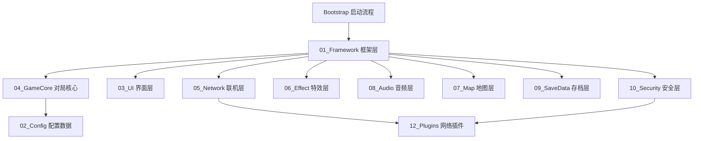
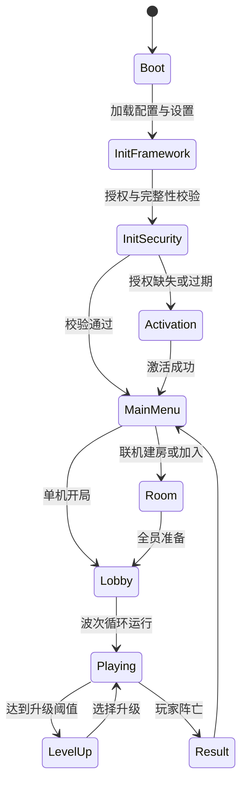
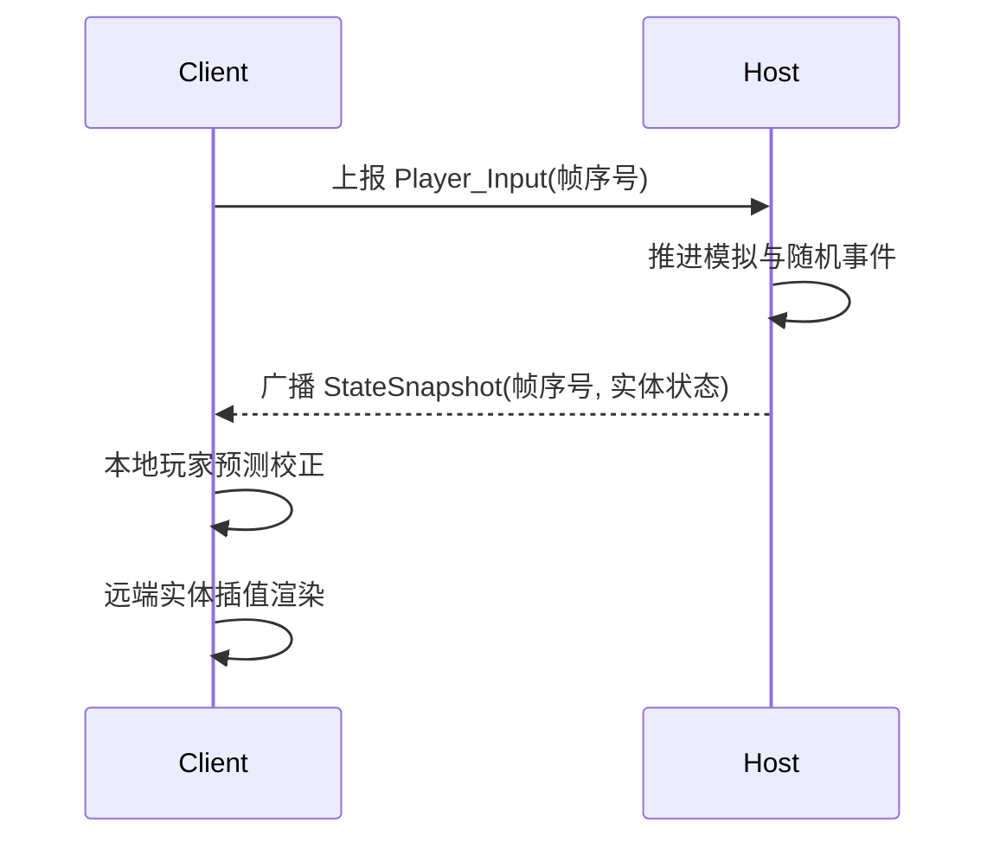
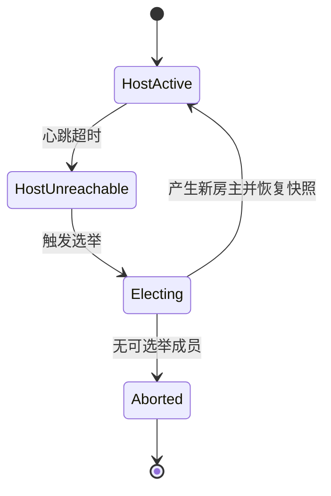
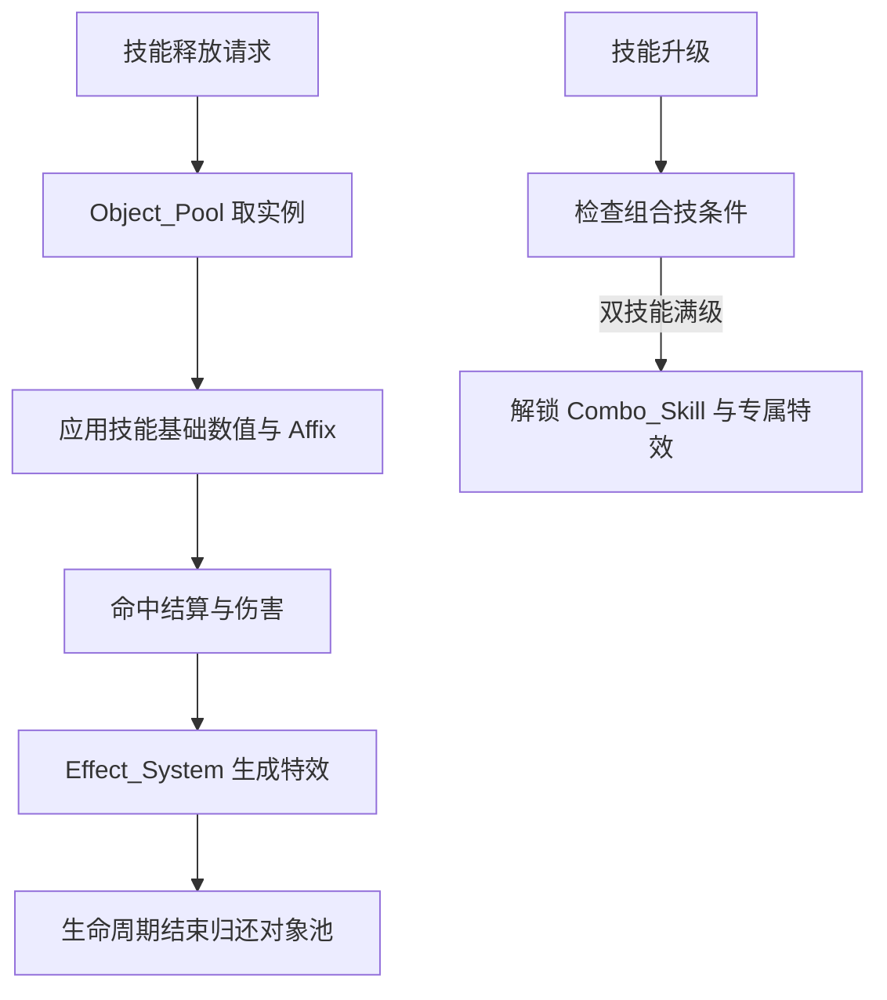

# 星界像素狂潮技术设计规格

Feature Name: star-pixel-surge
Updated: 2026-10-16

## Description

本文档描述星界像素狂潮（Star Pixel Surge）V2.0 正式上线版本的技术设计。设计面向 Unity 2022.3 LTS + C#，覆盖工程架构、渲染与特效、核心对局循环、技能与 Build、波次 AI、多人联机、性能优化、存档、卡密授权、防破解、打包分发。

关键取舍：

- 联机采用房主权威状态广播模型。房主模拟全部 Entity 与随机事件，向客户端广播状态快照；客户端上报输入并对本地玩家做预测、对远端实体做插值。全端确定性模拟不作为联机前提。
- 卡密联网验证与云存档本期以本地实现为主，服务端接口以契约形式预留，通过 `ILicenseService` 与 `ICloudSaveService` 抽象隔离，后续替换实现即可接入远端。
- 需求、设计合并为单份总纲规格，供立项评审与并行开发引用。

## Architecture

### 全局模块结构



单例服务与依赖方向自 01_Framework 向外单向展开。SkillManager、WaveManager、EffectManager 由 GameManager 在对局生命周期内统一驱动；NetManager 在联机模式下接管输入与状态来源。

### 单例服务与生命周期



### 联机权威模型与数据流

房主在固定逻辑帧率（默认 30 Hz）推进模拟并广播快照；客户端以 60 Hz 渲染，对本地玩家输入做客户端预测，对远端实体在快照之间做插值。



### 房主迁移状态机



选举规则：从剩余客户端中选择加入房间顺序最早且心跳可达的成员作为新房主；新房主以最后确认的 Frame_Index 快照恢复模拟，对局不重开。

### 技能与组合技流程



## Components and Interfaces

### 框架层 01_Framework

- `Singleton<T>`：线程安全懒加载单例基类，提供 `Instance` 属性与 `OnDestroy` 释放。
- `GameManager`：`StartMatch(MatchConfig)`、`EndMatch(MatchResult)`、`RestartMatch()`、`Pause()`、`Resume()`，持有对局状态机。
- `UIManager`：`Open<T>(args)`、`Close<T>()`、`PushModal(view)`、`PopModal()`，维护单一模态窗口。
- `Timer` 与 `EventBus`：轻量帧计时与类型化事件分发，用于模块解耦。
- `ObjectPool<T>`：`Get()`、`Release(T)`、`Prewarm(count)`，供 Effect_System、Wave_System、Skill_System 共用。

### 配置层 02_Config

- `SkillConfig`、`ClassConfig`、`WaveConfig`、`AffixConfig`、`ComboConfig`、`MapThemeConfig`：以 ScriptableObject 或加密 JSON 形式存放，运行时由 `ConfigService` 统一加载与索引。
- `ConfigService`：`LoadAll()`、`GetSkill(id)`、`GetClass(id)`、`GetWave(layer)`、`GetAffixes(pool)`，提供只读访问并缓存索引。

### 界面层 03_UI

- HUD、主菜单、设置、房间、结算、图鉴、激活界面视图类，基类 `UIView`。
- `UIManager` 负责视图注册、层级与显示隐藏；HUD 订阅 Build_Profile 与生命值事件刷新。

### 对局核心 04_GameCore

- `PlayerController`：读取 Player_Input，驱动移动与技能触发；在联机模式下通过输入缓冲与预测校正。
- `Entity`：角色、怪物、召唤物、弹道的公共基类，暴露 `Tick()`、`ApplyDamage()`、`Recycle()`。
- `SkillSystem/SkillManager`：`GrantSkill(id)`、`LevelUpSkill(id)`、`CastSkill(id, context)`、`TryUnlockCombo()`。
- `AffixSystem`：`RollAffixes(skill, count)`、`ApplyAffix(skill, affix)`。
- `BuildProfile`：单局 Build 容器，记录技能等级、Affix、道具与增益，提供 `RecalculateStats()`。
- `WaveSystem/WaveManager`：`StartWaves()`、`SpawnGroup(groupId)`、`AdvanceLayer()`、`SpawnBoss()`。
- `MonsterAI`：`AcquireTarget()`、`MoveToTarget()`、`Attack()`。
- `ComboSystem`：维护组合技定义与触发条件，监听技能等级变更。

### 联机网络 05_Network

- `NetManager`：`CreateRoom()`、`JoinRoom(roomId)`、`LeaveRoom()`、`SetReady(bool)`、`StartMatch()`。
- `FrameSyncService`：`SubmitInput(PlayerInput)`、`BroadcastSnapshot(StateSnapshot)`、`ApplySnapshot(StateSnapshot)`，维护 Frame_Index 单调时间轴与插值缓冲。
- `InputBuffer`：按 Frame_Index 存放输入，房主按帧消费。
- `HostMigrationService`：`OnHostTimeout()`、`ElectNewHost()`、`RestoreFromSnapshot(snapshot)`。
- `RoomService`：名册、准备态、玩家进出与踢出。
- 传输层通过 `12_Plugins` 的 UDP 插件实现，`ITransport` 接口屏蔽具体实现。

### 特效与表现 06_Effect

- `EffectManager`：`Play(effectId, position, tier)`、`Recycle(instance)`。
- `GraphicsTierController`：`ApplyTier(Graphics_Tier)`，向特效、粒子、镜头、后处理广播当前档位。
- `CameraFeedback`：`Shake(intensity, duration)`、`Flash()`、`FreezeFrame(frames)`。
- `HitFeedback`：按伤害档位触发闪光、拖尾、震动。

### 地图 07_Map

- `MapGenerator`：`Generate(themeId, seed)`，依据主题与种子生成地形、障碍、陷阱、宝箱点位。
- `SceneMechanic`：天气、天灾等场景机制的抽象基类与具体实现。

### 音频 08_Audio

- `AudioManager`：`PlayBgm(segment)`、`PlaySfx(sfxId)`、`SetIntensity(level)`，负责 BGM 分段切换与音效播放。

### 存档 09_SaveData

- `SaveManager`：`Load()`、`Save()`、`SyncCloud()`、`RestoreBackup()`。
- `SaveSerializer`：本地加密序列化与版本迁移。
- `ICloudSaveService`：云端同步契约，本期提供 `LocalCloudSaveService` 实现，后续替换为远端实现。

### 安全 10_Security

- `SecurityManager`：`VerifyIntegrity()`、`ValidateLicense()`、`ActivateLicense(key)`、`GuardValue(ref value, baseline)`。
- `AntiDebug`：`DetectDebugger()`、`ApplyResponse(action)`。
- `IntegrityChecker`：`VerifyAssemblies()`、`VerifyResources()`，比对发布快照哈希。
- `ILicenseService`：授权校验契约，本期提供 `LocalLicenseService`（本地缓存 + 过期判断），预留 `RemoteLicenseService` 接入联网验证。

### 打包与工具 13_Editor

- `BuildPipelineTool`：一键出包、资源加密、AB 打包、版本号写入。
- `ConfigValidationTool`：技能、组合技、波次配置的一致性校验（引用存在、数值范围合法）。

## Data Models

### 技能配置 SkillConfig

```
SkillConfig {
  string id
  string displayName
  SkillType type            // Projectile | Summon | Area | Aura
  float baseDamage
  float damagePerLevel
  float baseRange
  float rangePerLevel
  float baseCooldown
  float cooldownPerLevel
  int   maxLevel
  string effectId
  string[] comboPartners
}
```

### 词条 AffixConfig

```
AffixConfig {
  string id
  string statKey            // damage | range | cooldown | crit | speed | count ...
  float  value
  AffixRarity rarity
  bool   isMultiplicative
  string[] tags
}
```

### 组合技 ComboConfig

```
ComboConfig {
  string id
  string skillA
  string skillB
  int    requiredLevelA
  int    requiredLevelB
  string fullScreenEffectId
  string linkedMechanicId
  bool   multiplayerOnly
}
```

### 波次 WaveConfig

```
WaveConfig {
  int    layer
  string themeId
  MonsterGroup[] groups
  int    healthScale
  int    speedScale
  int    countScale
  bool   hasBoss
}
```

### 存档 SaveData

```
SaveData {
  int    schemaVersion
  string[] unlockedClasses
  CodexEntry[] codex
  long   points
  SettingsRecord settings
  string checksum
}
```

### 网络包 NetworkPacket

```
PlayerInputPacket { int playerId; int frameIndex; Vector2 moveDir; int skillSlot; bool cast }
StateSnapshot    { int frameIndex; EntityState[] entities; int waveLayer; uint rngState }
EntityState      { int entityId; byte type; Vector2 position; float health; ushort stateFlags }
```

快照按帧序号排序应用；缺失帧通过相邻快照插值，超出保留窗口的过期快照丢弃。

## Correctness Properties

1. Frame_Index 在单局内单调递增，且每个客户端应用的快照不产生回退。
2. 房主迁移后新房主恢复的 WaveLayer 与 Entity 集合等于最后确认快照，对局不重开。
3. 每个从 Object_Pool 取出的实例在生命周期结束时归还，池内总量有界。
4. 单局内技能实例与怪物实例的并发上限满足需求 6.5 与 7.6（各不低于 1000）。
5. 组合技仅当其两个前置技能同时达到最高等级时解锁。
6. 单机模式下 multiplayerOnly 组合技不进入可解锁集合。
7. Graphics_Tier 变更只影响变更后生成的实例，不破坏进行中对局的一致性。
8. Save_Data 写入原子化，任意时刻的中断不破坏上一份有效存档。
9. License_Key 状态在本地缓存有效期内保持稳定，越过有效期后重新校验。

## Error Handling

| 场景 | 处理策略 |
|------|----------|
| 配置缺失或被引用错误 | ConfigService 加载期记录错误并回退到安全默认值；ConfigValidationTool 在打包前拦截 |
| 存档读取失败或校验和不匹配 | 尝试备份，仍失败则以新档初始化并提示玩家 |
| 授权服务不可达 | 使用本地缓存授权，超过有效期内重新校验 |
| 完整性校验不通过 | 记录事件并终止会话 |
| 检测到调试器 | 记录事件并执行配置的保护响应 |
| 房主心跳超时 | 触发选举，新房主从最后快照恢复 |
| 快照丢包 | 使用相邻快照插值，过期快照丢弃 |
| 对象池耗尽 | 扩容至上限或回收最早实例，记录告警 |
| 帧率持续低于阈值 | 提示玩家建议的 Graphics_Tier |

## Test Strategy

- 单元测试（Unity Test Framework，EditMode）：SkillConfig 数值成长、Affix 叠加与乘法/加法、ComboSystem 解锁条件、SaveData 序列化与校验和、ConfigService 索引与缺失回退、LocalLicenseService 过期判断。
- 集成测试（PlayMode）：Object_Pool 申请与归还、WaveSystem 分层递增与分批生成、BuildProfile 重算、Effect 分级切换。
- 联机测试：InputBuffer 帧对齐、StateSnapshot 插值收敛、HostMigrationService 选举与恢复（以本地多实例 + 模拟丢包/延迟注入）。
- 性能测试：1000 怪物 + 1000 技能实例场景下的帧率、GC 分配与对象池命中率；三档 Graphics_Tier 分别测量。
- 安全测试：完整性校验、反调试钩子、数值篡改响应的触发路径。
- 打包测试：Windows 安装包安装与启动、桌面快捷方式、资源加密后运行时加载、授权弹窗流程。

## References

[^1]: 星界像素狂潮项目立项与开发文档（用户提交，2026-10-16）
[^2]: (requirements.md) - 本特性需求文档（同目录）
